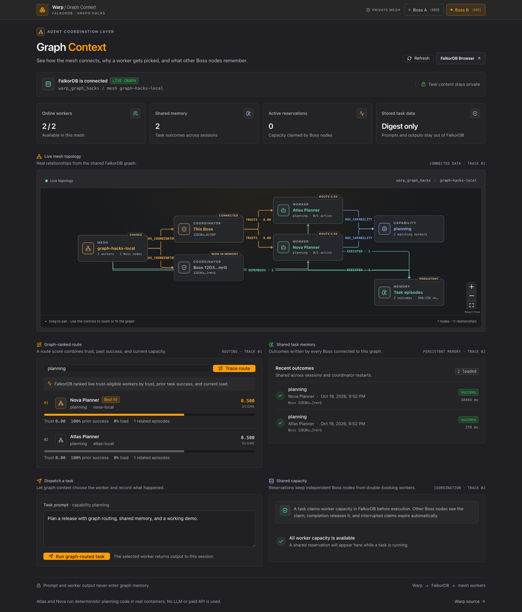
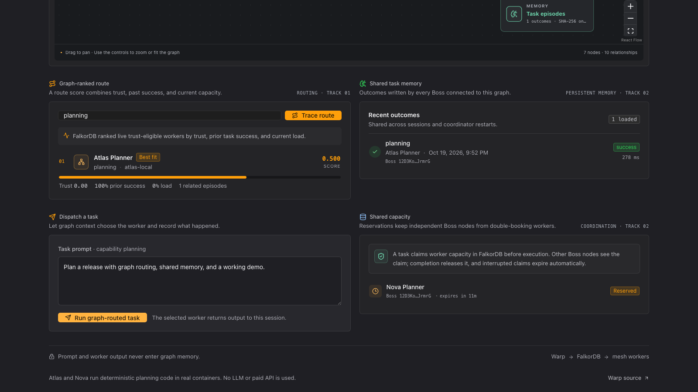
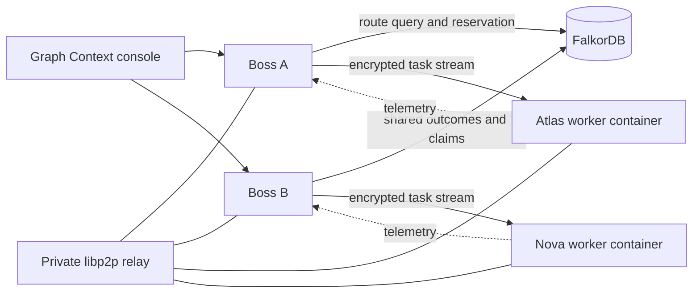
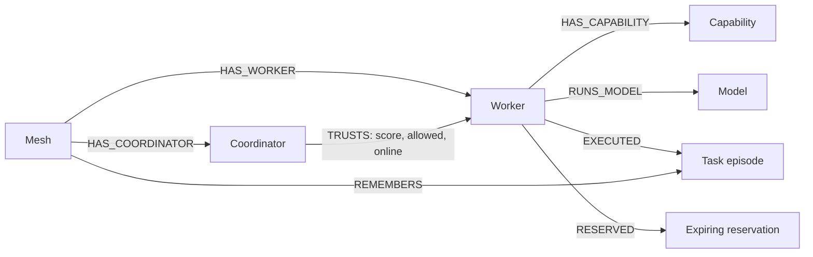

<div align="center">
  <h1>WARP</h1>
  <p><strong>A peer-to-peer agent mesh with shared graph memory.</strong></p>
  <p>FalkorDB helps independent coordinators choose capable workers, learn from completed tasks, and reserve shared capacity.</p>
  <p>
    <a href="https://github.com/kris70lesgo/warpg">Source</a> ·
    <a href="docs/falkordb-hackathon.md">FalkorDB guide</a> ·
    <a href="docs/hackathon-submission.md">Hackathon submission</a> ·
    <a href="output/warp-hackathon-final.mp4">Demo video</a>
  </p>
  <p>
    
    
    
  </p>
</div>

---

## What Warp does

A team may run several agents on different machines, containers, or private networks. A coordinator needs more than a list of online workers: it needs to know which workers support a task, which workers it trusts, what each worker is doing, how similar tasks ended, and whether another coordinator has already claimed capacity.

Warp joins those facts in FalkorDB. The graph ranks eligible workers, gives the route a readable explanation, stores compact task outcome memory, and lets separate Boss gateways coordinate reservations. The chosen worker still runs through Warp's peer-to-peer libp2p mesh inside its configured container runtime.

Warp is built for developers and operators who want to run agent workloads across a mesh while retaining control of the workers and keeping coordination history available across sessions.

### Hackathon tracks

- **Track 01 — Agents That Act on Connected Data:** worker capabilities, coordinator-specific trust, live workload, and relevant task history participate in worker selection.
- **Track 02 — Agent Memory and Coordination:** successful and failed task episodes persist in a shared graph, and atomic expiring reservations help independent coordinators avoid double-booking a worker.

## See it

The console shows graph health, a live topology, ranked route candidates, task history, reservations, and a task dispatch form.





**[Watch the demo video](output/warp-hackathon-final.mp4)** · **[Open the full-size graph screenshot](assets/screenshots/warp-graph-context.png)**

## Run the full FalkorDB demo

The local demo starts FalkorDB, a private libp2p relay, two real containerized worker agents, two independent Boss gateways, and the browser console. The included agents run deterministic planning code; they do not require a model download, paid inference service, or API key.

### Requirements

- Go 1.25 or later
- Node.js 20 or later and npm
- Python 3.10 or later
- Docker Engine with the Docker Compose plugin

The launcher targets macOS and Linux. Docker Desktop and OrbStack provide a Docker Engine on macOS.

### Start

From the repository root:

```bash
python3 scripts/demo.py up
```

Open [Boss A](http://127.0.0.1:5173/demo.html?apiPort=8080). The second gateway is available at [Boss B](http://127.0.0.1:5173/demo.html?apiPort=8081).

| Service | Address |
|---|---|
| Boss A API | `http://127.0.0.1:8080` |
| Boss B API | `http://127.0.0.1:8081` |
| Browser console | `http://127.0.0.1:5173/demo.html` |
| Private libp2p relay | `127.0.0.1:4015` |
| FalkorDB | `127.0.0.1:6380` |
| FalkorDB Browser | `http://127.0.0.1:3001` |

The demo uses graph `warp_graph_hacks` and mesh ID `graph-hacks-local`. Database and browser ports bind to loopback. FalkorDB runs from the pinned `falkordb/falkordb:v4.22.1` image and stores data in a named Docker volume.

Useful lifecycle commands:

```bash
python3 scripts/demo.py status
python3 scripts/demo.py verify
python3 scripts/demo.py verify --restart-db
python3 scripts/demo.py down
```

`verify` exercises a failed task, a successful task, shared memory, changed route ranking, an in-flight reservation visible to the other Boss, rejection of a capacity conflict, and recovery after a Boss restart. `--restart-db` additionally checks that graph data survives a FalkorDB container restart. The report is written to the ignored `.warp-demo/verification.json` directory.

`down` stops the Warp processes and keeps FalkorDB's volume. To stop FalkorDB as well:

```bash
docker compose -f compose.falkordb.yml down
```

Docker retains the named volume. Remove it only when you want to erase the local demo graph.

## How FalkorDB is used



FalkorDB is an active part of graph-enabled dispatch. A Boss first checks the live mesh for reachable and trust-eligible workers. A Cypher query follows graph relationships for the requested capability, combines those candidates with relevant task outcomes and current capacity, and returns the route used for execution.

### Graph model



Nodes represent meshes, coordinators, workers, capabilities, models, task episodes, and reservations. A worker's task history and capabilities are scoped to its mesh. Trust and reachability are scoped to the coordinator that observed them, so one Boss cannot overwrite another Boss's trust view. Use distinct graph names for separate tenants.

### Route selection

For each live eligible candidate, Warp combines the coordinator's trust score, the success rate of related past task episodes, and available capacity:

```text
route score = 0.50 × trust + 0.30 × prior success rate + 0.20 × available capacity
```

A candidate without relevant task history starts at a neutral success rate of `0.5`. Offline, stale, disallowed, overloaded, and marked equivocating workers are excluded before the route is returned. The console exposes the selected peer and the factors that contributed to its score.

### Persistent memory and reservations

On completion, Warp records an episode with the task class, worker, capability, model, coordinator, outcome, duration, completion time, source, and a SHA-256 digest of the prompt. Raw prompts and worker responses are not written to FalkorDB. A digest is still a deterministic hash: a predictable or short prompt may be guessed, so the digest is not anonymization and should not be treated as a privacy guarantee.

Before dispatch, a graph write checks active claims and creates a time-bounded reservation for the selected worker. Other Boss gateways using the same graph can see that claim and avoid booking the same capacity. Completion or failure releases the claim; if a process stops unexpectedly, the claim expires after its bounded lease. Worker-side admission control remains the final check if capacity changes after routing.

When FalkorDB is configured, a database error fails graph-enabled dispatch instead of silently routing without graph context. Leaving `FALKORDB_ADDR` unset keeps the existing graph-free deployment mode available.

## API quick reference

The graph endpoints live under the Boss HTTP API:

| Endpoint | Purpose |
|---|---|
| `GET /v1/graph/status` | Graph identity, worker counts, episode count, active reservations |
| `GET /v1/graph/memory?limit=20` | Recent task episodes (limit is clamped from 1 to 100) |
| `GET /v1/graph/route?capability=planning` | Ranked candidates, selected peer, score factors, explanation |
| `GET /v1/graph/reservations` | Current claims with worker, task, coordinator, and expiry |
| `POST /v1/chat/completions` | OpenAI-compatible graph-ranked task dispatch |

Example requests against the local demo:

```bash
curl 'http://127.0.0.1:8080/v1/graph/status'
curl 'http://127.0.0.1:8080/v1/graph/route?capability=planning'
curl 'http://127.0.0.1:8081/v1/graph/memory?limit=20'
curl 'http://127.0.0.1:8081/v1/graph/reservations'
curl http://127.0.0.1:8080/v1/chat/completions \
  -H 'Content-Type: application/json' \
  -d '{"model":"planning","messages":[{"role":"user","content":"Plan a release"}]}'
```

Chat responses include `warp_peer_id` and `warp_task_id` attribution fields. If you configure `WARP_API_KEYS`, use a bearer token for protected `/v1` requests:

```bash
curl http://127.0.0.1:8080/v1/graph/status \
  -H 'Authorization: Bearer your-token'
```

## Build from source

### Go gateway and mesh node

```bash
cd warp-go
go build -o build/warp ./cmd/warp
./build/warp --help
```

A single `warp` binary provides worker, API, interactive Boss, relay, witness, and key-generation modes. For workers, install Podman (the default container runtime) or specify Docker with `-runtime docker`. See [CLI guide](docs/cli.md), [worker guide](docs/worker.md), and [private mesh guide](docs/private-swarms.md).

There are no public Warp release installers yet. Use the source build above.

### Python SDK

```bash
cd warp-python
python -m pip install -e .
```

The SDK imports from `warp`. Example:

```python
from warp import WarpClient

with WarpClient(gateway_url="http://127.0.0.1:8080") as client:
    workers = client.workers.list()
    print(workers)
```

See the [Python SDK guide](warp-python/README.md) and runnable [SDK examples](warp-python/examples/).

### Desktop application

The Electron and React source is in `warp-desktop/`. See its [desktop guide](docs/DESKTOP.md) for building the native app and bundled backend. The browser-based FalkorDB console is the quickest way to explore the hackathon work.

## Repository map

```text
warp-go/       Go mesh node, API gateway, worker runtime, FalkorDB integration
warp-python/   Typed Python SDK for the Warp HTTP/OpenAI-compatible API
warp-desktop/  Electron desktop app and browser demo console
warp-web/      Static project site and API playground
scripts/       Local demo orchestration and submission packaging
demo/          Deterministic agent image used by the FalkorDB demo
docs/          Architecture, API, operations, and hackathon guides
output/        Submission video and reviewed Warp screenshots
```

## Configuration reference

The full demo sets these values for both Boss gateways:

| Variable | Meaning |
|---|---|
| `FALKORDB_ADDR` | FalkorDB host and port; leave unset to disable graph mode |
| `FALKORDB_GRAPH` | Graph name shared by coordinators that share memory and capacity |
| `FALKORDB_MESH_ID` | Namespaces workers and episodes inside a graph |
| `FALKORDB_USERNAME` / `FALKORDB_PASSWORD` | Optional database credentials |
| `FALKORDB_TLS` | Set to `true` for a TLS-protected database connection |
| `WARP_API_KEYS` | Comma-separated bearer tokens accepted by the HTTP gateway |

Read [FalkorDB setup](docs/falkordb-hackathon.md), [HTTP API](docs/http-api.md), and [authentication](docs/auth.md) before exposing a gateway beyond loopback.

## Project status, attribution, and license

This repository is a hackathon-focused Warp submission. It builds on the AgentFM open-source peer-to-peer mesh foundation; the Warp name, FalkorDB graph coordination work, demo, and submission materials are documented here. See [UPSTREAM.md](UPSTREAM.md) for project history and attribution. The root project includes its Apache-2.0 license; consult component manifests for additional license terms.

The local demo uses deterministic workers to make graph routing and coordination reproducible. It does not demonstrate production scale, exactly-once execution, an LLM provider integration, or a hosted public mesh. See [known limitations](docs/hackathon-submission.md#known-limitations) for the current boundaries.
