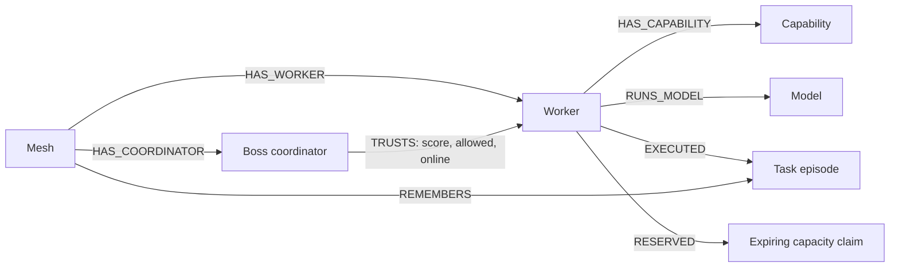

# Warp Graph Context

Warp uses FalkorDB to select workers from connected mesh data, remember task outcomes across sessions, and coordinate capacity between independent Boss gateways. The existing libp2p mesh executes the selected agent in a real container.

## Run the complete local demo

Install Go 1.25+, Node.js 20+, npm, Python 3.10+, and a running Docker Engine with Docker Compose. Docker Desktop and OrbStack both work. No API key or model download is required.

From the repository root:

```bash
python3 scripts/demo.py up
```

The launcher builds the Go binary and demo image, creates a private swarm, starts a local relay, two container workers, two independent Boss gateways, and the browser console. It installs frontend dependencies if needed. It keeps process logs and generated keys under the ignored `.warp-demo/` directory.

Open [Boss A](http://127.0.0.1:5173/demo.html?apiPort=8080) and [Boss B](http://127.0.0.1:5173/demo.html?apiPort=8081). Both use the same persistent graph, `warp_graph_hacks`, and mesh, `graph-hacks-local`.

| Service | Local address |
|---|---|
| Boss A | `127.0.0.1:8080` |
| Boss B | `127.0.0.1:8081` |
| Browser console | `127.0.0.1:5173/demo.html` |
| Private relay | `127.0.0.1:4015` |
| FalkorDB | `127.0.0.1:6380` |
| FalkorDB Browser | `127.0.0.1:3001` |

FalkorDB uses dedicated host ports to coexist with an ordinary Redis service on port 6379. Compose pins FalkorDB 4.22.1, enables append-only persistence, and keeps its data in a named volume. The database and browser bind to loopback.

The included Atlas and Nova workers run deterministic planning code in real Docker containers. They produce a plan and downloadable artifacts; they do not call an LLM. Warp also accepts your own agent images, including agents backed by local models or external inference APIs.

### Verify the two tracks

```bash
python3 scripts/demo.py verify
# Also exercise disk persistence across a database restart:
python3 scripts/demo.py verify --restart-db
```

The live checks execute a controlled failed task and successful tasks, show that another Boss reads the outcomes, confirm that the successful worker ranks higher, inspect a shared in-flight reservation, reject a conflicting dispatch, and restart a Boss to recover its memory. The optional final check restarts the FalkorDB container and verifies persisted graph data. Results are written to `.warp-demo/verification.json`.

```bash
python3 scripts/demo.py status
python3 scripts/demo.py down
```

`down` stops the demo processes and retains FalkorDB and its memory. To stop the database too, run `docker compose -f compose.falkordb.yml down`; the named volume is retained.

### Interactive walkthrough

1. Open Boss A. Inspect the selected worker and its trust, prior success, load, and related task count.
2. Run a task using capability `planning`. The result identifies the actual selected peer, and the outcome appears in shared memory.
3. Enter `DEMO_SLOW` at the start of a prompt to keep a task running for six seconds. `DEMO_HOLD` runs for eighteen seconds for a longer demonstration.
4. While the task runs, open Boss B. Its coordination panel shows the same reservation. Its route can use another available worker.
5. Run the verifier to see a controlled failure change subsequent routing and to demonstrate process restart recovery.

The recorded walkthrough is [output/warp-hackathon-final.mp4](../output/warp-hackathon-final.mp4). The graph screenshot is [output/playwright/warp-graph-context.png](../output/playwright/warp-graph-context.png). To record it again, install FFmpeg and run `node scripts/record_warp_demo.mjs` after the demo is up.

## Graph model



Worker state and episodes are scoped by mesh ID. Each Boss retains its own trust and reachability edges, so another Boss cannot overwrite its reputation decision or make a reachable worker appear disconnected. Use separate graph names for separate tenants.

Graph initialization is protected by a shared lock. Exact-match indexes and unique constraints protect mesh, coordinator, worker, capability, model, task, and reservation identities during concurrent startup and updates.

### Track 01: connected data determines execution

The gateway first obtains currently reachable, trust-eligible workers. FalkorDB follows coordinator trust and worker capability relationships, joins related prior task outcomes, accounts for live load and active reservations, and ranks candidates:

`score = 0.50 × trust + 0.30 × prior success rate + 0.20 × available capacity`

A worker with no relevant history starts at a neutral success rate of 0.5. Offline, stale, overloaded, disallowed, and equivocating workers are excluded. The query result determines the worker selected by the OpenAI-compatible gateway. The route preview exposes the factors behind that decision.

### Track 02: persistent memory and shared coordination

Completed task episodes contain task class, worker, capability, model, coordinator, outcome, duration, completion time, source, and a SHA-256 prompt digest. Raw prompts and response text are omitted from the graph. Future routes reuse the related outcomes.

Before dispatch, a single graph write checks shared worker capacity and creates an expiring reservation. Other Boss nodes immediately see that claim. Completion records the episode and removes the claim; failure paths release capacity too. Interrupted processes leave bounded claims that expire just beyond the task deadline.

The worker's own admission control remains the final capacity check when telemetry changes between selection and execution. Graph-enabled dispatch returns 503 if FalkorDB cannot be used; it does not silently bypass graph coordination.

## API

These routes use the same bearer authentication as other `/v1` endpoints when `WARP_API_KEYS` is configured. The private demo runs on loopback without an API key.

| Endpoint | Result |
|---|---|
| `GET /v1/graph/status` | Graph and mesh identity, worker counts, completed episode count, active reservation count |
| `GET /v1/graph/memory?limit=20` | Recent task episodes, clamped to 1–100 |
| `GET /v1/graph/route?capability=planning` | Ranked candidates, selected peer, score factors, explanation |
| `GET /v1/graph/reservations` | Active claims with worker, task, coordinator, creation time, and expiry |
| `POST /v1/chat/completions` | Graph-ranked execution using model, name, peer ID, or capability |

Chat and text completion responses include `warp_peer_id` and `warp_task_id` for attribution. The desktop **Graph Context** page uses these same APIs. Its topology canvas renders live mesh, coordinator, worker, capability, and task-memory relationships with zoom and pan controls; route candidates and saved episodes remain alongside the graph.

```bash
curl 'http://127.0.0.1:8080/v1/graph/route?capability=planning'
curl http://127.0.0.1:8081/v1/graph/memory
curl http://127.0.0.1:8081/v1/graph/reservations
curl http://127.0.0.1:8080/v1/chat/completions \
  -H 'Content-Type: application/json' \
  -d '{"model":"planning","messages":[{"role":"user","content":"Plan our next release"}]}'
```

## Enable FalkorDB in an existing Warp deployment

```bash
docker compose -f compose.falkordb.yml up -d --wait
cd warp-go
go build -o warp ./cmd/warp
FALKORDB_ADDR=127.0.0.1:6380 FALKORDB_GRAPH=warp FALKORDB_MESH_ID=my-mesh \
  ./warp -mode api -apiport 8082
```

Use a free API port if the demo gateways are running. For Electron, launch `warp-desktop/scripts/dev.sh` with the same FalkorDB environment variables and configure the desired public or private project in the app. All Boss nodes that should share outcomes and reservations must use the same graph and mesh identifiers.

Remote connections also support `FALKORDB_USERNAME`, `FALKORDB_PASSWORD`, and `FALKORDB_TLS=true`. An unset `FALKORDB_ADDR` leaves the existing graph-free deployment mode available. Workers can choose Docker with `-runtime docker`; Podman remains the default.

## Inspect the graph in FalkorDB Browser

Select `warp_graph_hacks` and run:

```cypher
MATCH (m:Mesh)-[:HAS_COORDINATOR]->(b:Coordinator)-[t:TRUSTS]->(w:Worker)-[:HAS_CAPABILITY]->(c:Capability)
RETURN m, b, t, w, c
```

```cypher
MATCH (w:Worker)-[:EXECUTED]->(task:Task)
RETURN w.name, task.task_class, task.outcome, task.coordinator, task.duration_ms
ORDER BY task.completed_at DESC LIMIT 20
```

```cypher
MATCH (w:Worker)-[:RESERVED]->(claim:Reservation)
RETURN w.name, claim.task_id, claim.coordinator, claim.expires_at
```

## Checks

```bash
cd warp-go
FALKORDB_TEST_ADDR=127.0.0.1:6380 go test -race ./internal/falkor ./internal/boss ./internal/worker ./cmd/warp
cd ../warp-desktop
npm run typecheck
npm test
npm run build
npm run build:demo
```

The real database checks use isolated temporary graphs and remove them afterward. They cover outcome-based ranking, digest-only memory, session persistence, mesh isolation, independent trust views, concurrent initialization, capacity contention, and lease expiry.

## Package the submission

Run `python3 scripts/package_submission.py` from the repository root to create `dist/warp-graph-hacks.zip`. It includes source, documentation, and the reviewed Warp MP4/screenshots while excluding dependencies, local keys, environment files, database state, and compiled binaries.
