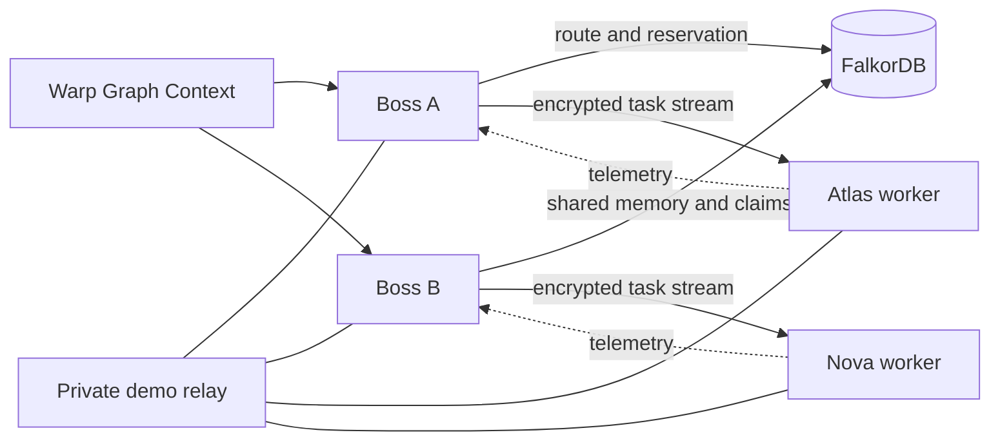

# Warp: graph memory and coordination for agent meshes

## Project summary

Warp is a peer-to-peer agent mesh that uses FalkorDB to make routing and coordination decisions from connected data. A Boss gateway combines worker capability, coordinator-specific trust, live load, and related task outcomes to select a worker. Multiple Boss gateways share task memory and atomically reserve worker capacity through the same graph.

**Tracks:** Track 01 — Agents That Act on Connected Data; Track 02 — Agent Memory and Coordination.

**Source:** <https://github.com/kris70lesgo/warpg>

**Demo video:** [Warp hackathon walkthrough](../output/warp-hackathon-final.mp4). Upload the MP4 to the submission form to create a public video link.

**Setup:** [Local FalkorDB demo guide](falkordb-hackathon.md). The project has no hosted deployment; the guide starts the complete demonstration locally.

## Problem

An agent mesh cannot route reliably from an online/offline list alone. The coordinator needs to know which workers can perform a task, which workers it trusts, what capacity is available, and how relevant earlier tasks ended. Independent coordinators also need a shared view of capacity so they do not each assume the same worker is free. If these facts disappear when a process restarts, every new session starts without useful experience.

## What Warp adds

The upstream AgentFM project supplied the initial peer-to-peer transport, container workers, HTTP/OpenAI-compatible gateway, reputation ledger, SDK, and desktop foundation. The Warp Graph Hacks work adds the FalkorDB-backed connected-data layer and its reproducible demo. See [project origin and attribution](../UPSTREAM.md).

FalkorDB stores a graph of meshes, coordinators, workers, capabilities, models, task episodes, and reservations. The graph supports two connected behaviors:

1. **Choose a worker from relationships and evidence.** The Boss filters the live mesh for reachable and trust-eligible peers, then uses FalkorDB to follow capability edges, read coordinator-specific trust, join related task outcomes, account for current capacity, and rank the candidates. The gateway dispatches to the selected peer over the existing libp2p transport.
2. **Share memory and reserve capacity.** Completed task episodes remain available across sessions and Boss restarts. Before dispatch, a graph write checks claims and creates a bounded reservation. Other Boss nodes using the same graph can see that claim. Completion releases it; an abandoned claim expires.

## Track 01: Agents That Act on Connected Data

The route is determined by graph data rather than a hard-coded worker preference. The current route score is:

```text
0.50 × trust + 0.30 × related-task success rate + 0.20 × available capacity
```

A worker without relevant episodes starts with a neutral success rate of `0.5`. Workers that are offline, stale, disallowed, overloaded, or marked as equivocating are excluded. The console shows the ranked candidates, selected peer, factors, and explanation. A task sent through the OpenAI-compatible gateway runs on that selected worker's real container.

## Track 02: Agent Memory and Coordination

A completed episode records its task class, worker, capability, model, coordinator, outcome, duration, completion time, source, and prompt digest. The raw prompt and response are not stored in FalkorDB. The prompt digest is deterministic and may be guessable for predictable prompts, so it must not be treated as anonymization.

Each coordinator's trust and reachability edges remain separate, while workers and task episodes are scoped to a mesh ID. Sharing a graph shares memory and reservations; separate graph names isolate tenants. Active reservations have bounded expirations so a stopped Boss cannot hold capacity forever. Worker-side admission control remains the final guard if load changes after the graph route is computed.

## Run and verify the demo

Requirements: Go 1.25+, Node.js 20+, npm, Python 3.10+, and Docker Engine with Docker Compose.

```bash
python3 scripts/demo.py up
python3 scripts/demo.py verify --restart-db
```

Open `http://127.0.0.1:5173/demo.html?apiPort=8080`; the second Boss is at `http://127.0.0.1:5173/demo.html?apiPort=8081`.

The verifier exercises controlled failure and success outcomes, cross-Boss memory reads, route changes, reservation visibility, conflicting-dispatch rejection, Boss restart recovery, and optional FalkorDB disk persistence. The included Atlas and Nova workers run deterministic planning code in real containers. They require no model download, API key, or paid inference endpoint. This makes the graph behavior repeatable; it does not imply that the demo agents use an LLM.

See the [live graph screenshot](../assets/screenshots/warp-graph-context.png), [capacity coordination screenshot](../assets/screenshots/warp-coordination.png), and [demo video](../output/warp-hackathon-final.mp4).

## Architecture



FalkorDB stores connected-data context, task episodes, and capacity claims. The live libp2p mesh supplies current reachability and transports work. The existing local reputation ledger retains signed trust evidence. Graph-enabled dispatch fails if FalkorDB is unavailable rather than silently bypassing graph coordination.

## Implementation and verification

The repository uses Go, FalkorDB's Go client, Cypher, libp2p, Docker or Podman, React, TypeScript, Electron, and Python for local demo orchestration. Compose pins FalkorDB 4.22.1 and persists graph data in a named volume.

Run the live verifier and focused builds with the commands in [the demo guide](falkordb-hackathon.md). The checked-in report at `docs/demo-verification.json` records an earlier 12-check run; rerun the verifier for the current checkout before relying on a new environment's result.

## Known limitations

- The included agents are deterministic planning workers. Warp does not bundle an LLM or inference provider.
- The repository provides a local demo, not a hosted deployment, managed public relay, or public worker marketplace.
- There are no public Warp desktop installers or PyPI release for the renamed package yet. Build from source.
- FalkorDB is the shared dependency for graph-enabled routing, memory, and reservations. It is not replicated across independent database clusters.
- A prompt digest is not an anonymization mechanism. Use trusted workers for sensitive prompts.
- A reservation prevents the demonstrated cross-Boss double booking, but it does not guarantee exactly-once work across network partitions or a worker crash.

## Submission assets

Use the public source repository and the demo video URL created after uploading `output/warp-hackathon-final.mp4`. The [FalkorDB page](https://www.wemakedevs.org/hackathons/falkordb) contains the event submission entry point. Add the team identity and any public video link required by the submission form.
